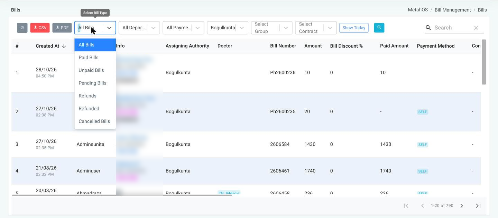

# Cancelling & Refunding Bills

MetahOS records **who** cancelled a bill, **who** refunded it and **when**, and shows that information on the bill lists, the payments report and the printed bill. Pharmacy staff can also cancel an unpaid pharmacy bill and return its medicines to stock.

## At a glance

```steps
fa-money | Bill raised | The bill is created and may be paid.
fa-ban | Cancel | The canceller and time are stored on the bill.
fa-undo | Refund | Each refund payment records who made it and when.
fa-list | Bill lists | Cancelled By and Refunded By columns, and a Refunded filter.
fa-print | Printout | Status, cancellation and refund details print on the bill.
```

## In the bill lists

**Bill Management → All Bills** has two new columns:

- **Cancelled By** — the person who cancelled the bill, with the date and time underneath. Shows `-` if the bill is not cancelled.
- **Refunded By** — the person who made the **most recent** refund on the bill, with its date and time.

A cancelled bill now shows the **Amount**, **Paid Amount**, **Contract Amount** and **Receivable** it had before it was cancelled, rather than zero, so you can see what was cancelled.

### The Refunded filter

The bill status filter has a **Refunded** option. The full list is: All Bills, Paid Bills, Unpaid Bills, Pending Bills, Refunds, Refunded and Cancelled Bills. The same filter is on **Pharmacy → Dispatched (beta)** and **Pharmacy → Dispensed**.



| Filter | Shows |
| --- | --- |
| **Refunds** | Bills with a refund **due** — money still to be returned to the patient. |
| **Refunded** | Bills that have been refunded in full: at least one refund was made and nothing remains paid. |

A fully refunded bill no longer appears under Paid Bills or Unpaid Bills, and OP bills show a **REFUNDED** badge.

### On the payments report

The payments report (Bill Management → Payments and Pharmacy → Pharmacy Transactions) has **Cancellation Details** and **Refund Details** columns, and both appear in its CSV and PDF exports. See [Payments Report](./payments-report.md).

## Cancellation details are kept

- The canceller and time are saved when the bill is **first** cancelled. Cancelling it again does not overwrite them.
- **Restore Bill** (available to roles that can cancel bills) clears them, since the bill is no longer cancelled.

:::note Bills cancelled before v1.0.81
For bills cancelled before this release, **Cancelled By** shows the last person who edited the bill, which may not be the person who cancelled it, and the pre-cancellation amounts show `-`.
:::

## Cancelling an unpaid pharmacy bill

A pharmacy bill that has not been paid can be cancelled by roles with the permission to cancel unpaid pharmacy bills (under **Pharmacy → Miscellaneous** in the Role editor).

The **Cancel Bill** button appears on **Pharmacy → Dispatched (beta)**, **Pharmacy → Dispensed**, and on pharmacy rows in **Bill Management → All Bills**, when all of these are true:

- The bill is a pharmacy bill and is not already cancelled.
- It is **not** an inpatient pharmacy bill.
- Its status is **Unpaid**.

To cancel, enter a **Reason for Cancelling Bill** — it is required — and confirm.

:::info Medicines go back to stock
Cancelling a dispensed pharmacy bill returns the dispensed medicines to inventory, less anything already returned. Earlier versions could not cancel a dispensed pharmacy bill at all.
:::

### When a pharmacy bill cannot be cancelled

The reason is shown in the message:

| Message | Why |
| --- | --- |
| *Inpatient pharmacy bills cannot be cancelled* | The bill belongs to an inpatient admission; this permission covers outpatient pharmacy bills only. |
| *Only unpaid bills can be cancelled…* | The bill is paid, part-paid, due a refund, refunded or not yet billed. |
| *Bill was paid before it could be cancelled* | A payment arrived while you were cancelling. |
| *Bill is already cancelled* | Someone else cancelled it first. |

### After cancelling

- A cancelled pharmacy bill can no longer be dispensed, edited or returned against.
- It **cannot be restored**, because its medicines have already gone back to stock.
- If a cancellation is interrupted part-way, the bill reports *Bill cancellation is incomplete, cancel the bill again*. Cancelling it again finishes the job.
