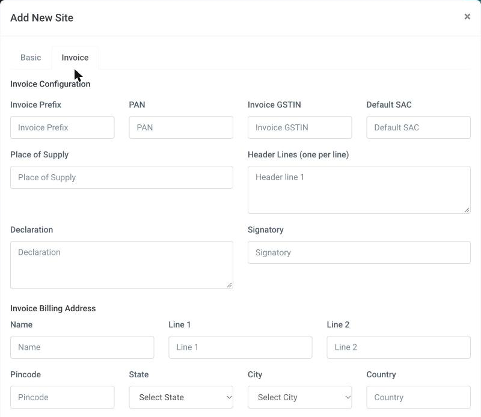
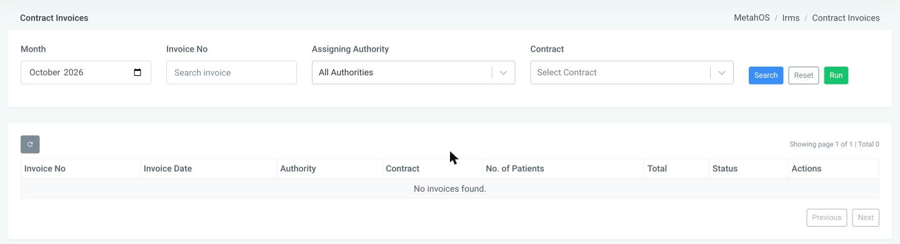

# Contract Invoices

**Contract Invoices** raises one invoice per month for each corporate contract at each site, covering everything billed to that contract in the month. Invoices for the previous month are generated automatically on the 1st of each month, and can also be run by hand. Open the list from **IRMS → Contract Invoices**.

## At a glance

```steps
fa-hospital-o | Set up the site | Invoice prefix, GSTIN, billing address and bank details.
fa-file-text-o | Set up the contract | Legal name, payment terms and addresses.
fa-refresh | Generate | Automatically each month, or with Run.
fa-search | Find an invoice | By month, invoice number, site or contract.
fa-file-pdf-o | View or download | Invoice details and the PDF.
```

## Before you start: site invoice details

The invoice header, numbering and bank details come from the site. Open **Facility → Site Management**, add or edit the site, and fill in the **Invoice** tab:



| Field | Used for |
| --- | --- |
| **Invoice Prefix** | The start of every invoice number for this site. If left blank, the site code is used. |
| **PAN**, **Invoice GSTIN** | Printed on the invoice. Invoice GSTIN falls back to the site's GST In. |
| **Default SAC** | The SAC code printed against the services. |
| **Place of Supply** | Printed on the invoice. |
| **Header Lines (one per line)** | The lines printed at the top of the invoice. If left blank, the site name and address are used. |
| **Declaration**, **Signatory** | The declaration text and the signing authority at the foot of the invoice. |
| **Invoice Billing Address** | Name, Line 1, Line 2, Pincode, State, City and Country. |
| **Bank Details** | Account name, account number, IFSC, bank name and branch, printed for payment. |

## Before you start: contract invoice details

On the contract (**IRMS → Contract Management**), the **Invoice Details** section holds the payer's **Legal Name**, **Terms (Days)**, and **Billing** and **Shipping** addresses (tick **Shipping same as Billing** to copy it). The terms set the invoice's **Due Date**: invoice date plus the number of days.

## What goes on an invoice

For the chosen month, an invoice collects every item on bills that:

- are billed to a **corporate** contract,
- were created in that month at that site,
- are not cancelled, and
- have not already been put on an invoice.

Items are grouped by site and contract, so each site–contract pair gets one invoice for the month. Once an item is invoiced it is never picked up again, and the bills on the invoice are **locked** so they cannot be changed afterwards. Trying to edit one shows *Bill is locked because invoice &lt;number&gt; has been generated*.

## The Contract Invoices screen



- **Month** defaults to last month. Narrow the list by **Invoice No**, **Assigning Authority** or **Contract**, then click **Search**. **Reset** goes back to the defaults.
- The list shows **Invoice No**, **Invoice Date**, **Authority**, **Contract**, **No. of Patients**, **Total** and **Status**, 20 invoices per page.
- **View** opens the invoice: its dates, the patients and tests on it, and the total. **PDF** opens the printable invoice.

### Statuses

| Status | Meaning |
| --- | --- |
| **Generating** | The invoice is being built. |
| **Generated** | The invoice and its PDF are ready. |
| **Failed** | Something went wrong. Running the month again retries it. |

### Running invoices by hand

**Run** generates invoices for the selected **Month**, for the selected authority or, if none is chosen, for all authorities. Invoices that were already generated for the same site, contract and month are left as they are, so running a month twice does not create duplicates.

:::caution
Running invoices locks the bills they cover. Make sure the month's billing is complete before you run it by hand.
:::
