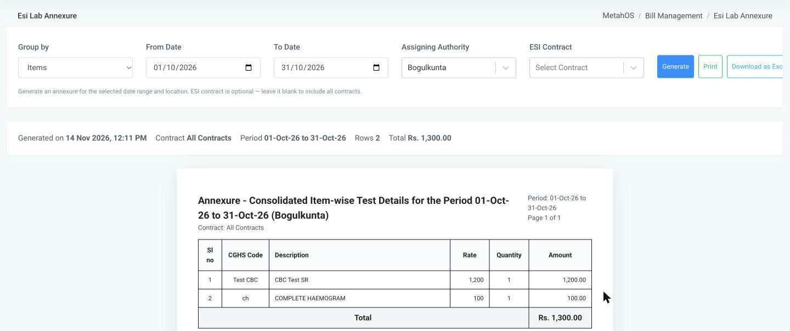

# ESI Lab Annexure

The **ESI Lab Annexure** is the monthly statement of lab tests that goes with an ESI claim. It lists the tests billed at a site over a date range, either test by test or bill by bill, ready to print or send as Excel. Open it from **Bill Management → ESI Lab Annexure**.

## At a glance

```steps
fa-calendar | Pick the period | From Date and To Date.
fa-hospital-o | Pick the site | The assigning authority is required.
fa-file-text-o | Contract (optional) | One ESI contract, or leave blank for all.
fa-list | Choose the grouping | Items or Bills.
fa-print | Generate | Then print or download as Excel.
```

## Generating the annexure

| Field | Notes |
| --- | --- |
| **Group by** | **Items** — one row per test, with quantity and amount. **Bills** — one row per bill and test, with patient details. |
| **From Date** / **To Date** | The billing period. The From Date cannot be after the To Date. |
| **Assigning Authority** | The site the annexure is for. Required. |
| **ESI Contract** | Optional. Choose one contract, or leave it blank to include **all contracts** — the annexure is then labelled *All Contracts* and includes every billed lab item for the site in the period, cash bills included. |

Click **Generate**. A summary line shows when it was generated, the contract, the period, the number of rows and the total.



### Items view

Titled *Annexure - Consolidated Item-wise Test Details*, with the columns **Sl no**, **CGHS Code**, **Description**, **Rate**, **Quantity** and **Amount**, and a grand total.

### Bills view

One row per test on each bill, with **Sl no**, **Date**, **Bill No**, **Patients UHID**, **Patients Name**, **Gender**, **Age**, **ESI Card Number**, **Doctor's Name**, **Test Name**, **Rate** and **Total Amount**.

## Printing and exporting

- **Print** prints the annexure page by page, with the period and page number on each page.
- **Download as Excel** saves the same rows as a spreadsheet.

Both work only after the annexure has been generated and has rows.

:::note
In earlier versions an ESI contract had to be chosen. It is now optional, so one annexure can cover all of a site's ESI work for the month.
:::
