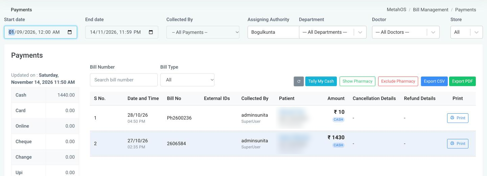

# Payments Report

The payments report lists every payment collected in a date range, with who collected it, how it was paid and what happened to the bill afterwards. It appears in three places:

- **Bill Management → Payments**
- **Pharmacy → Pharmacy Transactions** — pharmacy bills only
- Inside **Cash Counter** shift management

## At a glance

```steps
fa-calendar | Pick a date range | The end date can't be in the future.
fa-search | Find a bill | Search by bill number, or filter OPD / IPD / pharmacy.
fa-list | Read the list | 20 payments per page, with cancellation and refund details.
fa-print | Print a bill | Reprint any bill straight from its row.
fa-download | Export | CSV or PDF of every matching payment.
```

## Choosing the dates

The **End date** cannot be later than today, and the **Start date** cannot be after the End date — the date pickers won't offer those days.

## Finding a payment

- **Bill Number** — type a bill number to find its payments. It is an **exact** match, so type the whole number. The search runs once you stop typing and returns you to the first page.
- **Bill Type** — **All**, **OPD** or **IPD**. OPD is non-pharmacy bills without an admission; IPD is non-pharmacy bills with one. (Not shown on Pharmacy Transactions, which only lists pharmacy bills.)
- **Show Pharmacy** / **Exclude Pharmacy** — with Bill Type set to All, *Show Pharmacy* lists pharmacy bills only. With **OPD** or **IPD** selected, it lists that type **plus** pharmacy bills, so you can see, say, all outpatient and pharmacy takings together. While one of these is active its button reads **Show All**; click it to go back. Changing the Bill Type resets them.

## The list



The report shows **20 payments per page**. Alongside the payment details, each row has:

| Column | Shows |
| --- | --- |
| **Cancellation Details** | A *Cancelled* badge, who cancelled the bill and when. |
| **Refund Details** | A *Refunded* badge, who refunded it and when. |
| **Print** | A **Print** button to reprint the bill (needs the permission to print bills). |

## Exporting

- **Export CSV** includes Cancelled By, Cancelled On, Refunded By and Refunded On, alongside the date, time, bill number, collector, patient and amount-by-payment-mode columns.
- **Export PDF** prints **every** matching payment, not just the page you are looking at, and includes the cancellation and refund details.

The export buttons need the data-export permission.

:::note
On large sites the report could previously time out before loading. It now loads normally, and the All Bills list is faster too.
:::
