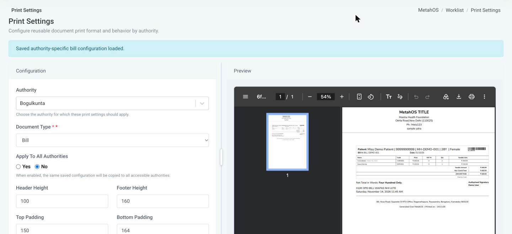

# Print Settings

**Print Settings** decides how printed documents look — bills, pharmacy bills and lab reports — and it is set **per authority**, so each site can print on its own letterhead, with its own margins and its own options. Open it from **Worklist → Print Settings**.

## At a glance

```steps
fa-cog | Open Print Settings | Worklist → Print Settings.
fa-hospital-o | Choose the authority | One site, or apply to all the sites you can access.
fa-file-text-o | Choose the document type | Bill, Pharmacy Bill or Lab Report.
fa-sliders | Set layout and options | Margins, header and footer, and the document's options.
fa-eye | Check the live preview | A real sample document with your unsaved changes.
fa-save | Save Print Settings | The change is saved and recorded in the audit history.
```

## The screen

The screen has two panes side by side — **Configuration** on the left and **Preview** on the right, with the **Audit History** below the preview. Drag the divider between them (or move it with the arrow keys) to give either pane more room.



### Choosing what to configure

1. **Authority** — the site whose settings you are editing. Only authorities you can access are listed.
2. **Document Type** — **Bill**, **Pharmacy Bill** or **Lab Report**. Only the types you have permission for are listed.
3. **Apply To All Authorities** — shown when you can access more than one authority. Choose **Yes** to copy the same settings to every authority you can access when you save. The Authority field is locked while this is on.

When the settings load, a message tells you where they came from: the authority's own saved settings, the shared hospital-wide settings, or — if the authority has never been configured — the existing settings as a starting point.

### Page layout

| Field | What it controls |
| --- | --- |
| **Header Height** / **Footer Height** | Space reserved at the top and bottom of each page. |
| **Top / Bottom / Left / Right Padding** | The margins around the printed content. |

### Preview mode

The **Preview Mode** sets how the header and footer are printed:

| Mode | What prints | Fields shown |
| --- | --- | --- |
| **Standard Header/Footer** (default) | A header and footer built from text and logos. | Header Title, Header Subtitle, Left Logo, Right Logo, Address (taken from the site, read-only), Contact, **Additional Header Content** (printed below the contact number), and Footer Content. |
| **With Custom Letterhead** | Your own header and footer images. | Header Image and Footer Image. |
| **Plain Paper** | Nothing in the header — a blank band of the header height is left for pre-printed stationery — and only the page number in the footer. | None. |

### Bill and Pharmacy Bill options

All of these are **Yes / No** and default to **No**:

| Option | Effect on the printed bill |
| --- | --- |
| **OPD Bill Footer Remark** | A line of text printed above the date (Standard mode only). |
| **Minimize Bill Print** | Smaller text and a more compact layout. |
| **No Alternate Color In Bill** | Turns off alternating row shading. |
| **Hide Prices From Payment Info** | Lists the payment modes without their amounts. |
| **Show Cleared Items In Bill** | Keeps cleared items on the bill. |
| **Show Item Codes In Bill** | Adds a **Code** column. |
| **Show Memo Type In Bill** | Prints **Cash Memo** or **Credit Memo**. |
| **Show Payment Strings In Bill** | Prints card and cheque reference details. |
| **Show Boarding Pass In Bill PDF** | Adds a pass with the doctor's name, floor, room and contact. |
| **Show Copy Bill** | Marks reprints as **COPY BILL**, with when and by whom it was printed. |
| **Hide Bill Footer** | Leaves out the footer, unless a custom footer image is set. |
| **Has No Consultation Queue** | Leaves out the token number and scheduled time. |

The Lab Report options are described in [Lab Report Print Settings](../laboratory/lab-report-print-settings.md).

### Live preview

The preview is a real PDF of the selected document, filled with sample data (*Demo Patient*) and showing your changes **before** you save them.

### Saving

Click **Save Print Settings**. The confirmation tells you whether the settings were saved for the selected authority or for several authorities.

## Audit history

Every save is recorded. The **Audit History** below the preview lists the changes for the selected authority and document type, and can be searched.

| Column | What it shows |
| --- | --- |
| Authority, Document Type | What was changed. |
| Changed By, Changed On | Who saved it, and when. |
| **Changes** | Each setting that changed, as *Label: old → new*. Images show as *Previous image → New image*. The first save shows *Initial settings saved*, and a save that changed nothing says so. |
| Scope | *Selected Authority*, or *All Selected Authorities (N)* when Apply To All was used. |

Entries made before this release show *Not recorded for this older entry* under Changes.

## How bills use these settings

- A bill prints with the settings of the **authority the bill belongs to**. Pharmacy bills use the **Pharmacy Bill** settings.
- The header and footer come only from the saved settings. A blank Header Title, Subtitle, Contact or Footer Content prints blank — it no longer falls back to the hospital's name.
- The **Print Bill** window no longer applies the old hospital-wide letterhead and padding options. Everything is controlled here.

:::info After the upgrade
The upgrade copies your existing hospital-wide print settings into Print Settings for each authority, so bills look the same as before. Review each authority afterwards if your sites need different letterheads.
:::

## Who can use Print Settings

Print Settings has its own permissions, under **Worklist → Print Settings** in the Role editor:

| Permission | What it allows |
| --- | --- |
| **View** | See **Print Settings** in the sidebar and open the screen. |
| **Edit** | Save changes. Without it the screen is view-only: the fields are disabled and there is no Save button. |
| **Bill** | Work with the **Bill** document type. |
| **Pharmacy Bill** | Work with the **Pharmacy Bill** document type. |
| **Lab Report** | Work with the **Lab Report** document type. |

A user needs the view permission **and** at least one document-type permission to use the screen.

:::caution Upgrading from v1.0.77
Print Settings used to be available to anyone with access to Settings. That no longer applies, and the new permissions are **not** added to existing roles. Until an administrator grants them, only users with all permissions can open Print Settings.
:::
