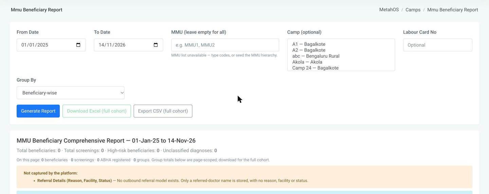

# MMU Beneficiary Report

The **MMU Beneficiary Report** brings together everything recorded for the beneficiaries screened by your **Mobile Medical Units** (MMUs) — vitals, investigations, diagnoses, high-risk conditions, medicines and ABHA status — in one report you can read on screen or download.

Open it from **Camps → MMU Beneficiary Report**. It needs access to the MMU Beneficiary Report, and only covers the authorities you can access.

## At a glance

```steps
fa-calendar | Choose the period | Defaults to the 1st of this month to today.
fa-ambulance | Pick MMUs or camps | Leave empty for all, or narrow to some.
fa-sitemap | Choose the grouping | Beneficiary-wise, MMU-wise or Date-wise.
fa-table | Generate Report | Totals, then one card per group.
fa-download | Download | Excel or CSV of the full cohort.
```

## How an MMU is recognised

An MMU is a site whose name starts with **MMU**, a number and an underscore — for example *MMU01_Bengaluru* is read as **MMU1**. MMUs are the lowest level of the DLC → ALC → LO → MMU hierarchy used by the [analytics dashboards](../analytics/dashboard-hierarchy-and-list.md).

:::caution Name your MMU sites consistently
Only sites named `MMU<number>_…` are included when you filter by MMU. A site named differently can still be reported by choosing it under **Camp**.
:::

## Filters



| Filter | Use |
| --- | --- |
| **From Date** / **To Date** | The screening period. |
| **MMU** | One or more MMUs, shown with their vehicle registration number. Leave empty for all. If the MMU list cannot be loaded, type the codes instead (for example *MMU1, MMU2*). |
| **Camp** (optional) | One or more camps, shown as *name — village*. |
| **Labour Card No** (optional) | One beneficiary's screenings. |
| **Group By** | **Beneficiary-wise** (default), **MMU-wise** or **Date-wise**. |

Click **Generate Report**.

## Reading the report

A summary card at the top gives the period and four totals: **beneficiaries**, **screenings**, **high-risk beneficiaries** and **unclassified diagnoses**.

Below it, each group is a card with its own counts — beneficiaries, screenings, abnormal vitals and ABHA registrations — and a table of screenings:

| Column | Shows |
| --- | --- |
| MMU, Date | Where and when the screening took place. |
| Labour Card | The card number, with a red **Expired** badge if the card has expired. |
| UHID, Beneficiary | The patient. |
| Vitals | Each vital marked **abnormal**, **normal** or **not checked**. |
| Investigations | Each test parameter with its value, unit and reference range. |
| Diagnosis | The diagnosis and the working diagnosis. |
| High-Risk Diseases | Diagnoses rated **Critical** or **High**, with their codes. |
| Medicines | Name, strength, dosage and quantity. |
| ABHA | Whether the beneficiary has an ABHA, and the number. |

The table shows 50 screenings per page.

### What "high-risk" means

A disease counts as high-risk when its diagnosis is rated **Critical** or **High** in the [diagnosis master](../clinician/diagnosis-severity.md). Diagnoses that have not been rated are counted separately as **unclassified** — they are not assumed to be low risk. Rating the common diagnoses makes this report more complete.

:::info Read these numbers with care
The report itself carries these notes:

- Medicines and vitals are linked to a screening by **calendar day**.
- Vitals recorded before range checking was introduced are shown as **not checked** rather than normal, because they were never compared with a range.
- High-risk diseases are matched by diagnosis name.
- **Referral details** (reason, facility, status) are not captured by the platform and so are not in the report.
:::

## Downloading

| Button | Produces |
| --- | --- |
| **Download Excel (full cohort)** | A workbook with sheets for Beneficiaries, Vitals, Investigations, Medicines, Clinical, ABHA, High Risk and Data Notes. |
| **Export CSV (full cohort)** | One row per screening, with every column in a single sheet — including camp, camp location, screening number, beneficiary type, gender, age, mobile, ABHA address, symptoms and allergies. |

Both cover the **whole** filtered cohort, not just the page on screen, up to **5,000 screenings**. If there are more, the download is cut off and says so — narrow the date range or the MMU filter and download in parts.
