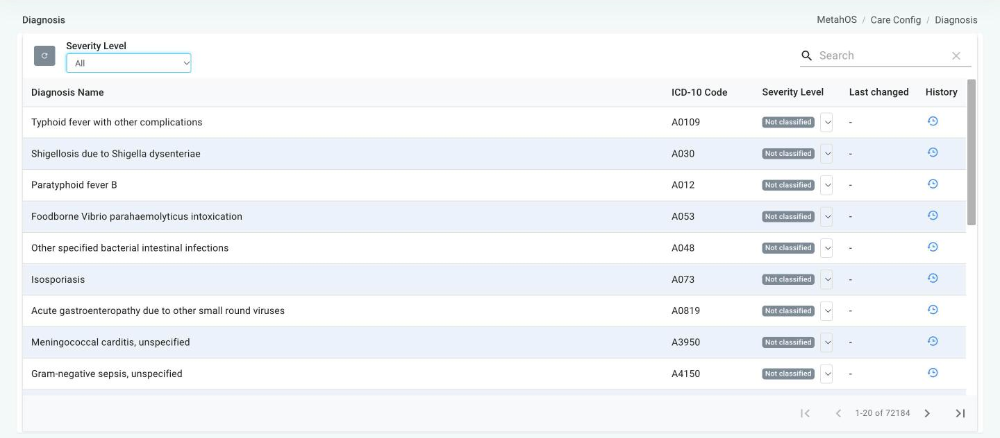

# Diagnosis Master & Severity Levels

Every ICD-10 diagnosis in MetahOS can carry a **severity level** — **Critical**, **High**, **Medium** or **Low**. The level is shown as a badge wherever a diagnosis is picked, and it is what reports such as the [MMU Beneficiary Report](../camps/mmu-beneficiary-report.md) use to decide which patients are high-risk.

Severity belongs to the **diagnosis**, not to one patient: setting *Type 2 diabetes mellitus* to High sets it for everyone, everywhere.

## At a glance

```steps
fa-list | Diagnosis master | Care → Diagnosis lists every ICD-10 diagnosis.
fa-sliders | Set the severity | Critical, High, Medium, Low or Not classified.
fa-user-md | Doctor adds a diagnosis | The badge shows beside it in the picker.
fa-question-circle | No severity yet? | Optionally, the doctor is asked to set one.
fa-history | Every change recorded | Who changed it, when, and from where.
```

## The diagnosis master

Open **Care → Diagnosis** (needs access to the Diagnosis master). The list holds the full ICD-10 catalogue; diagnosis names and codes are read-only.



| Column | What it shows |
| --- | --- |
| **Diagnosis Name** | The ICD-10 description. Sortable. |
| **ICD-10 Code** | The code. Sortable. |
| **Severity Level** | A coloured badge and a dropdown to change it. |
| **Last changed** | Who last changed the severity, and when. |
| **History** | A clock icon that opens the change history. |

Search by name or code, and use the **Severity Level** filter (All, Not classified, Critical, High, Medium, Low) to find diagnoses that still need a level.

### Setting a severity

Choose a level from the row's dropdown. It saves immediately. Choosing **Not classified** clears the level.

| Level | Badge |
| --- | --- |
| Critical | Red |
| High | Amber |
| Medium | Blue |
| Low | Green |
| Not classified | Grey |

This screen is the only place a severity can be **changed** or **cleared** once set. If someone else changed the same diagnosis while you had the list open, you are asked to reload and try again.

### Change history

The clock icon opens **Severity history** for that diagnosis, newest first: the date and time, who made the change, the previous and new severity, and **where** it was made — *Diagnosis master* or *Consultation*.

## Badges in the diagnosis pickers

Wherever a diagnosis is chosen, each option and each added diagnosis shows a grey **ICD code** badge and, if one is set, the coloured **severity** badge:

- the **Working Diagnosis** in the OP consultation screen;
- the IP prescription diagnosis, IP working diagnosis and admission-from-OPD diagnosis;
- the diagnosis field in forms built with the Form Builder.

Diagnoses added by voice and diagnoses loaded from saved records show the badges too. A diagnosis without a severity shows only its code. Diagnoses typed in by hand, outside the ICD-10 list, have neither.

## Asking doctors to classify

Your organisation can choose to ask for a severity at the moment a diagnosis is used. When this is turned on and a doctor adds a diagnosis that has **no severity yet**, a **Set risk level** window appears:

> This diagnosis has no risk level yet. Choosing one updates it for everyone, and it will be used in reporting.

- Pick **Critical**, **High**, **Medium** or **Low**, then **Save & add**. The diagnosis is added and the level is saved for everyone.
- Or choose **Skip for now**. The diagnosis is added without a level, and you won't be asked about that diagnosis again until the page is reloaded.

From the consultation, a doctor can only **fill in** a missing severity — never change one. If a colleague set it a moment earlier, you'll be told it already has a risk level.

### Turning it on

Two site settings control the prompt, and both are off by default. Ask your MetahOS administrator to turn them on:

| Setting | Effect |
| --- | --- |
| **Prompt for diagnosis risk** | Shows the **Set risk level** window to users who have access to the Diagnosis master. |
| **Let doctors classify** | Together with the first setting, lets **any** doctor (other than referral doctors) answer the window. |

The badges are shown whether or not the prompt is turned on.

:::tip Classify the common diagnoses first
Filter the master by **Not classified** and work through the diagnoses your clinics use most. Turning on the prompt then fills in the long tail as doctors meet it.
:::

:::info
Severity levels are for staff and reporting only. They are never shown to patients, and a patient's record stores the diagnosis itself, not its severity.
:::
