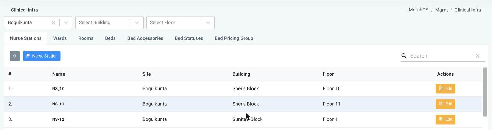
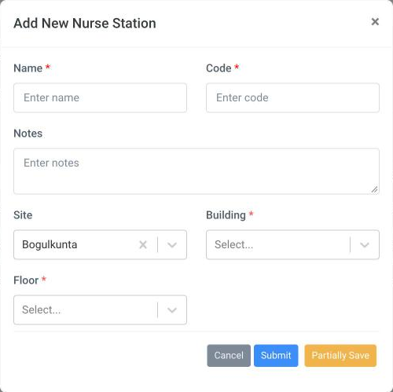
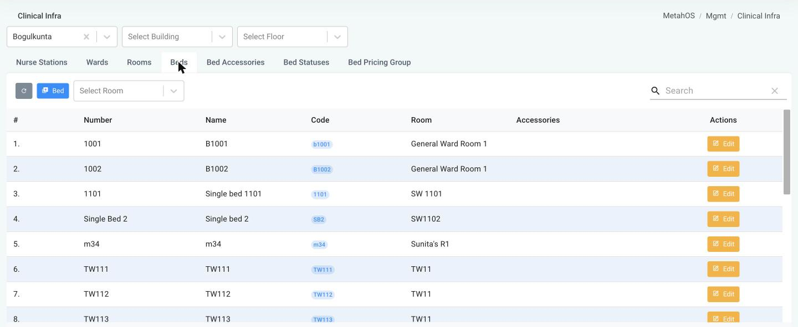

# Clinical Infra Management

**Clinical Infra Management** is where a site's inpatient layout is set up: nurse stations, wards, rooms and beds, along with bed accessories, bed statuses and bed pricing groups. Open it from **Facility → Clinical Infra Management**.

The buildings, floors and rooms it builds on come from [Site Management](./add-a-site.md), so set those up first.

## At a glance

```steps
fa-building | Set up the site | Buildings, floors and rooms in Site Management.
fa-user-md | Add nurse stations | Each one sits on a building and floor.
fa-th-large | Add wards | Each ward belongs to a nurse station.
fa-bed | Add beds | Each bed sits in a room, with optional accessories.
fa-tags | Statuses and pricing | Bed statuses, accessory rates and pricing groups.
```

## Filtering the screen

The bar at the top narrows every tab to one **authority** (site), and optionally one **Building** and **Floor**. Pick these first so new records land in the right place.

## The tabs



| Tab | What it holds | Main fields |
| --- | --- | --- |
| **Nurse Stations** | The nursing posts that look after wards. | Name, Code, Notes, Site, **Building**, **Floor** |
| **Wards** | Groups of rooms run from one nurse station. | Name, Code, Notes, Nurse Station |
| **Rooms** | The site's rooms (shared with Site Management). | As in Site Management |
| **Beds** | Individual beds. | Bed Name, Number, Code, Room, Accessories |
| **Bed Accessories** | Chargeable extras attached to a bed, such as a monitor. | Name, Rate, Unit (**/hr**, **/day**, **/week** or **/use**) |
| **Bed Statuses** | The states a bed can be in, each with a colour. | Name, Color |
| **Bed Pricing Group** | Pricing groups and the authorities they apply to. | Name, Assigning authorities |

Each tab has a button to add a record and an **Edit** button on every row.

## Adding a nurse station

Click **Nurse Station** on the Nurse Stations tab:



**Name**, **Code**, **Building** and **Floor** are required. The Floor list only shows floors of the chosen building. If Building or Floor is left empty, the form shows *Please select Building* or *Please select Floor* and does not save.

**Submit** saves and closes the form. **Partially Save** saves the record and moves you on to the next tab, which is handy when building a new layout from top to bottom.

## Adding beds

On the **Beds** tab, filter by **Room** to see one room's beds, or leave it empty to see them all:



Give each bed a name, number and code, choose its **Room**, and attach any **Accessories** set up on the Bed Accessories tab.
