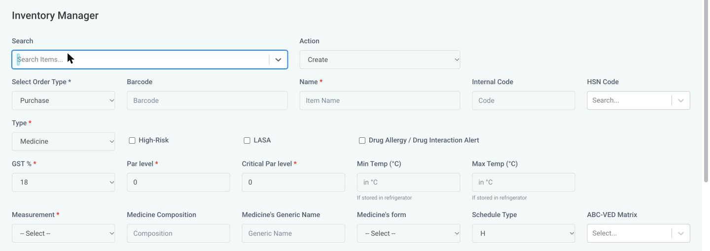

# High-Risk, LASA & Scheduled Medicines

Medicines can be flagged as **High-Risk** or **LASA** (Look-Alike, Sound-Alike), and carry a **drug schedule**. These follow the medicine everywhere it is selected — prescribing, dispensing and stock issue.

## At a glance

```steps
fa-flask | Flag the item | Mark the medicine as high-risk, LASA, or both.
fa-search | Selecting a medicine | The flag shows in the search results.
fa-exclamation-triangle | Badge shown | A coloured badge appears next to the name.
fa-check | Safer choice | The person picking is warned before they commit.
```

## Setting the flags

Open the item under inventory item management. Three checkboxes are available for medicines:

- **High-Risk** — a medicine where an error is likely to cause serious harm.
- **LASA** — a medicine whose name or packaging is easily confused with another.
- **Drug Allergy / Drug Interaction Alert** — marks a medicine whose allergy and interaction risk depends on what it contains.

A medicine can carry any combination of these flags.



:::info Composition is required for drug alerts
When **Drug Allergy / Drug Interaction Alert** is ticked, **Medicine Composition** becomes a required field and the item cannot be saved without it (*Medicine composition is required*). The composition is what identifies the active ingredients, so the flag is only meaningful with it filled in.
:::

## Drug schedule

Each medicine has a **Schedule Type**: **H**, **H1**, **X** or **G**. Schedules **X** and **G** are new in this version.

- New medicines default to **H**, and a schedule must always be chosen — the placeholder cannot be saved.
- Older items saved before a schedule was set have none, and show no schedule badge until edited.
- The inventory list can be filtered by schedule — see [Item Barcodes & Filters](./item-barcodes-and-filters.md).

When you pick a batch for a scheduled medicine, the batch selector heading reads **Batch No. \* (Schedule &lt;value&gt;)** for any schedule. Earlier versions only marked H1 drugs.

## Where the badges appear

Once flagged, the medicine is badged wherever it is chosen or listed:

- The **medicine autocomplete** used when prescribing.
- The **prescription medicine list**.
- The **inventory item list**.
- The **batch selector** when issuing stock outward.
- The **pharmacy dispatch** selector rows.

**High-Risk** is shown in red and **LASA** in amber, so the two are distinguishable at a glance.

A blue **Schedule &lt;value&gt;** badge (for example *Schedule X*) appears beside them in the consultation medicine autocomplete, the prescription medicine list and the pharmacy dispatch selector.

:::note
Because new medicines default to schedule **H**, most medicines saved through the item form will show a *Schedule H* badge. Check the schedule when you create an item, especially for **X** and **H1** drugs.
:::

:::tip
Flag LASA pairs on **both** medicines, not just the one that gets confused more often. The badge is only useful if it appears whichever of the pair the person is looking at.
:::

:::caution
The badge is a prompt, not a block. It does not prevent the medicine being selected — it is there so the person making the choice looks twice.
:::
