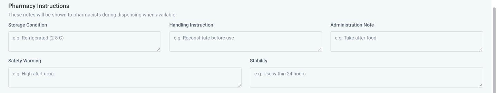

# Pharmacy Instructions

Each medicine can carry short **Pharmacy Instructions** — how to store it, how to handle it, how it is given, and any safety warning. Pharmacists see them while dispensing, so the advice travels with the medicine instead of living in someone's head.

## At a glance

```steps
fa-flask | Open the medicine | Inventory Manager, for a purchase item.
fa-pencil | Fill in the instructions | Storage, handling, administration, safety warning, stability.
fa-save | Save the item | The notes are stored with the medicine.
fa-info-circle | Dispense | An info button opens the Medicine Instructions window.
```

## Adding instructions to a medicine

Open the item in **Inventory Manager** (Facility → Inventory Management → Item Manager). For purchase items, a **Pharmacy Instructions** section sits below the medicine details:



| Field | Use it for | Example |
| --- | --- | --- |
| **Storage Condition** | Where and how the medicine is kept. | *Refrigerated (2-8 C)* |
| **Handling Instruction** | Anything to do before giving it. | *Reconstitute before use* |
| **Administration Note** | How the patient should take it. | *Take after food* |
| **Safety Warning** | A caution the pharmacist must not miss. | *High alert drug* |
| **Stability** | How long it lasts once opened or prepared. | *Use within 24 hours* |

All five are optional free text. Leave a field blank if it does not apply.

### Refrigerated medicines

If **Min Temp (°C)** or **Max Temp (°C)** is filled in on the same form, the storage line is built for you — for example *Refrigerated at 2-8°C*, *Refrigerated at 2°C* or *Refrigerated up to 8°C* — and shown above any Storage Condition you typed.

When both temperature fields are blank, no refrigeration line is shown. (Before v1.0.81, a blank temperature could produce a false *Refrigerated* line; that is fixed.)

## Seeing the instructions while dispensing

On the pharmacy dispensing and dispatch screens, a medicine that has at least one instruction shows a small blue **info** button next to its batch selection. Click it to open the **Medicine Instructions** window, which lists each instruction that has been filled in. The **Safety Warning** is highlighted so it stands out.

Medicines with no instructions show no button, so the screen stays uncluttered.

:::tip
Use **Safety Warning** for the one thing that must not be missed, and keep it short. Use [High-Risk and LASA flags](./high-risk-and-lasa-medicines.md) as well for medicines that need a badge everywhere they are picked.
:::
