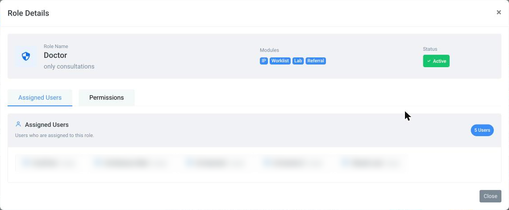

# Managing Users & Resources

The **Manage Users** and **Manage Resources** pages under HR are where employees and
doctors are created, edited and organised. This page covers the recent additions to the
user form and the bulk-upload views.

## At a glance

```steps
fa-users | Manage Users / Resources | Here is what happens at this step.
fa-plus | Create individually or bulk? | Here is what happens at this step.
fa-user | Open tabbed user form | Here is what happens at this step.
fa-check | Set Reg. No. and Designation | Here is what happens at this step.
fa-file-text-o | Assign authority and reporting line | We pick a helper for the job.
fa-download | Download existing list | Here is what happens at this step.
fa-tv | Edit spreadsheet | Here is what happens at this step.
fa-upload | Upload to add or update | Here is what happens at this step.
fa-user | User or resource saved | Here is what happens at this step.
```

## The User Form

Creating or editing a user opens a tabbed form. Two fields worth calling out:

- **Reg. No.** — the professional registration number for
  the user. This is captured on the form and **printed on bill invoices** beside the
  name of the person who raised the bill, shown as *Reg. No.: &lt;number&gt;*.
- **Designation** — the employee's job title, captured on the
  **Organization** tab under Employment Details.

:::tip Registration number on invoices
The registration number flows from the user who created a bill item onto the printed
invoice automatically. Make sure clinical staff who raise bills have their **Reg. No.**
filled in so it appears on patient-facing documents.
:::

### Username vs. full name

Across the HR module, name columns show **both** the login **username** and the person's
**full name** (first + middle + last). The Manage Users table, the Attendance Details
list and other people pickers display both so administrators are never confused by two
employees with the same display name.

Names are length-checked on save, so an over-long name cannot be stored and then be
truncated inconsistently in tables, reports and printed documents.

### Roles in the user and resource lists

Both lists now show which roles each person holds, so an administrator can check access
without opening every record:

- **Manage Users** has a **Roles** column between **Type** and **Authority Access**.
- **Manage Resources** (the doctors list) shows **Roles** where the **Qualification**
  column used to be. The qualification is still stored on the doctor's record — it is
  only no longer shown in this table.

Roles are listed by name, separated by commas. A person with no role shows `-`. The
column cannot be sorted.

### Profile photo

A user's profile photo may be up to **5 MB**. A larger file is rejected as soon as
it is chosen, with a message, so the form cannot be submitted with an upload that
would fail.

## Generating doctor user IDs

**Manage Resources** has a **Generate User IDs** action for issuing sign-in IDs to
doctors in bulk — filling in doctors who have none, or renumbering the whole estate.
It requires the permission to manage doctor user IDs. See
[Doctor User IDs](../security/doctor-user-ids.md).

## Managing roles

Roles are edited from **HR → Manage Roles** (needs access to Manage Roles). The role
editor lists permissions grouped by the module and screen they apply to, so a role can be
given access to one worklist without opening up the rest of a module. Newly introduced
permissions are never added to an existing role automatically — an administrator has to
grant them deliberately.

### Role details

The **Details** button on each role opens a **Role Details** window, so you can see who
holds a role and what it allows before you change it.



The header shows the role name, its description (or *No description provided*), and a
badge for each module its permissions belong to. The window has two tabs:

| Tab | What it shows |
| --- | --- |
| **Assigned Users** (opens first) | Every staff user and doctor who holds the role, sorted by name, with their user type. A disabled account carries a grey **Inactive** badge. The count appears at the top of the tab. |
| **Permissions** | Each permission in the role, using the same label as the role editor (for example *CAN ACCESS LAB IP PENDING ?*), with the module it belongs to. A role that grants everything shows **All Permissions**. |

:::note Who you can see
If you can only access some authorities, the Assigned Users tab lists only users who share
one of your authorities, plus users who can access every authority.
:::

If the user list cannot be loaded, the tab shows *Unable to load assigned users* with a
retry button; the rest of the window still works.

## Designation & Authority

Each user can be assigned a **designation** (their title) and one or more **assigning
authorities** (the sites they belong to). Riders and online-only users are mapped to the
configured online authority automatically. Reporting lines are independent of
department: any user or doctor can report to any other user or doctor.

## Bulk Upload (Excel/CSV Views)

Several HR areas accept spreadsheet uploads instead of entering rows one at a time:

- **Manage Resources** lets you download the current doctor list (CSV) and upload a file
  to add or update resources in bulk.
- **Rota** provides an **Upload Rota Sheet** action so an entire roster can be imported
  from a spreadsheet rather than built shift-by-shift.

:::tip
When using a bulk upload, download the existing list first and edit that file — it
already has the correct column headings, which keeps the import clean.
:::
