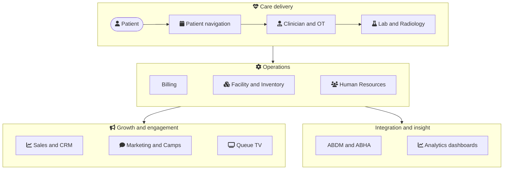

# Welcome to the MetahOS Guide

This is your complete, hands-on manual for **MetahOS — the Healthcare Operating System**. Whether you run the front desk, a lab, the pharmacy, an operating theatre, or the whole hospital, you'll find step-by-step workflows and a visual **"Workflow at a glance"** diagram on almost every page.

:::tip New here? Take it in three steps
1. Read **[What is MetahOS](#what-is-metahos)** to understand what the platform does.
2. Skim **[The platform at a glance](#the-platform-at-a-glance)** to see how the modules fit together.
3. Pick your area from the sidebar — each module opens with a diagram, then detailed how-to pages. Hover any diagram node for a quick explanation.
:::

## What is MetahOS

MetahOS is a Healthcare Operating System that runs across the **continuum of care** — from a patient's first enquiry, through consultation, diagnostics, admission and billing, all the way to follow-up and engagement. It brings every department onto one platform so your teams can focus on treating patients, not wrestling with technology.

Check out our health stack:

### For hospitals

A single platform for OPD, IPD, OT, diagnostics, pharmacy, HR, inventory, billing and more:

### Build your own EMR

As a practising doctor you can build your own EMR on MetahOS — arrange the consultation screen, macros and care plans around how *you* work. The clinician section walks you through it.

### Built-in Data Lake

MetahOS ships with a full Data Lake so you can integrate every existing system in your institution and augment it with new capabilities — no rip-and-replace required.

## The platform at a glance

Here's how the major modules connect — the patient moves through care delivery, which feeds operations, growth and integration:

## How this guide is organized

This guide is **versioned to match the product** — you're reading **v1.0.81**. Every module section opens with a *Workflow at a glance* diagram, followed by task-focused pages with the exact buttons, fields and permissions.

The sidebar is grouped by how a healthcare team actually works:

- **Patient journey** — Patient Navigation, Pre-Doctor / Secretary, Clinician, IP, OT, MRD, Referral
- **Diagnostics** — Laboratory & Diagnostics, Radiology
- **Operations** — Human Resources, Facility & Inventory, Billing & Payments
- **Growth & engagement** — Sales & CRM, Marketing, Queue TV, Notifications, Camps
- **Integration & insight** — ABDM / ABHA, Analytics & AI Dashboards
- **Build & extend** — Form Builder, Authentication, Security, Workflow Engine, Integration with MetahOS

:::note How to read the diagrams
Each *Workflow at a glance* diagram uses icons to show the steps and decisions in a flow. **Hover over any node** for a one-line explanation, and toggle the moon/sun in the top bar to switch between light and dark.
:::

## What's new in v1.0.81

Since v1.0.77, the biggest changes are in the laboratory, printing and billing, and clinical risk reporting:

- **Laboratory** — a new **Accession Pending** status and worklist; outsourced tests tracked as Sample Collected → Sent → Uploaded → Completed, with external files released only once received and in-house reporting locked after an upload; the report opens as a full page that keeps your list's filters; scan a barcode from any lab list to open its order; rejecting a sample at collection with a mandatory reason; TAT in minutes, hours or days; an audit history for every test definition; and new permissions for IP Pending, IP Completed and three worklist columns.
- **Print Settings** — bills, pharmacy bills and lab reports are now laid out **per authority**, with letterhead modes, a live PDF preview, an audit history of every change, and their own permissions.
- **Billing** — who cancelled and who refunded a bill is shown in the lists, the payments report and the printout, with a new **Refunded** filter; unpaid pharmacy bills can be cancelled with their medicines returned to stock; and the payments report gains bill-number search, an OPD/IPD filter and pagination.
- **Clinical** — a **diagnosis master** where every ICD-10 diagnosis can be rated Critical, High, Medium or Low, with severity badges in the diagnosis pickers.
- **Camps** — an **MMU Beneficiary Report** of every screening by your mobile medical units, with high-risk diseases, vitals, investigations, medicines and ABHA status.
- **Patients** — ages entered at registration now advance with time, and ages of 100 or more can be entered.
- **HR** — roles shown in the user and doctor lists, and a Role Details view of who holds a role and what it allows.
- **Inventory & Facility** — drug schedules X and G with a schedule badge, a drug-alert flag that requires the composition, and stricter vendor, HSN and package-name rules.
- **Subscription** — deployments linked to the Super Admin Portal show payment reminders and can go read-only while a subscription is overdue.

:::caution Upgrading from v1.0.77 — check your roles
Several new permissions are not added to existing roles automatically: **Print Settings** (view, edit, and one per document type), **IP Pending / IP Completed** and the **Ordered By, Token Number and Resulting ICs** lab columns. Until they are granted, users without all permissions will not see these.
:::

## Start today

Questions or onboarding? Reach us at **contact@m16labs.com** or visit [metahos.com](https://metahos.com).

Prefer video courses? Everything here is also available at [learn.metahos.com](https://learn.metahos.com).
