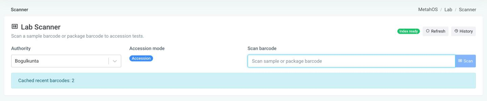

# Accession & the Lab Scanner

Accession is the point at which the lab formally takes charge of a sample. This page covers the simplified single-stage accession and the **Lab Scanner** screen, which accessions samples by scanning their barcodes.

## At a glance

```steps
fa-flask | Sample collected | The sample is taken from the patient.
fa-truck | Received at the lab | The sample reaches the laboratory bench.
fa-barcode | Scan the barcode | Point the scanner at the label on the tube.
fa-check | Accessioned | The lab accepts the sample and it becomes reportable.
fa-pencil | Results can be entered | The test moves into Report Pending.
```

## Single-stage accession

Accession used to happen twice — a **general** acceptance followed by a separate **department** acceptance — and a test could not be reported until both were done.

Sites can now collapse this into **one** stage. When they do:

- The step is labelled simply **Accession**.
- Department accession disappears from the worklist: the column, the per-row button and the bulk action are all hidden.
- Only the single accession is required before results can be entered.

:::info Nothing is lost
Switching to single-stage accession changes only what is *required* and what is *shown*. Historic department-accession records — including department rejection reasons — are preserved, so reports and analytics built on them keep their history.
:::

:::note If you are switching over
Tests that are already generally accepted but still awaiting department acceptance stay in **Accession Pending** until something else is written to them. Clearing the department accession queue before the switch avoids this entirely.
:::

## The Lab Scanner

The **Lab Scanner** appears in the Lab sidebar for users whose role includes the Lab Scanner permission. (On sites still running two accession stages it is labelled **Accession Scanner**.)

It turns accession into a single physical motion: pick up the tube, scan the label, put it down. There is no need to find the patient in a list first.



### Using the scanner

1. Open **Lab → Lab Scanner**.
2. Put the cursor in the scan box and scan the barcode on the sample. A hand-held barcode gun types the value and submits it for you.
3. The result appears at the top of the results list immediately; keep scanning without waiting.

Both label types are understood:

- **Sample barcodes** — accession every test that shares that sample.
- **Package barcodes** — accession every test on the order that shares that label's tube (the same barcode identifier). Cleared tests are left alone.

### Reading the results

Each scan produces a coloured result card showing the patient, the order and the tests affected:

| Result | What it means |
| --- | --- |
| **Processing** | The scan is being looked up. |
| **Accessioned** | The sample was accepted; the tests are now reportable. |
| **Already accessioned** | This sample had already been accepted — no action, no error. |
| **Blocked** | The sample cannot be accessioned yet, for example because it has not been collected or received. The card explains why. |
| **Not found** | No sample or test matches the barcode that was scanned. |
| **Failed** | The accession could not be saved. Scan again. |

:::tip
**Already accessioned** is a normal outcome, not a mistake. Re-scanning a tube that a colleague has already processed is safe — it will never accession anything twice.
:::

### Scan history

The scanner keeps a history of what was scanned, by whom and what the outcome was. Open it from the scanner screen to check a batch after the fact, or to confirm that a particular tube was handled.

Each barcode in the history is a link. Clicking it opens the lab report page in a new tab, showing only the tests that scan touched.

## Searching by barcode from any lab list

You don't have to go to the Lab Scanner to find an order by its barcode. The lab lists — **Pending** and each of its status screens, **Completed**, **Cleared**, **Home Collection**, **IP Pending** and **IP Completed** — have a round **barcode button** in the bottom-right corner.

```steps
fa-barcode | Scan the tube | Scan anywhere on the list, or open the barcode box.
fa-search | Order found | The barcode is matched to its bill.
fa-file-text-o | Report opens | The lab report page opens on that order's tests.
```

- **Scan straight onto the page.** With a barcode gun you don't need to click anything first: a scan made anywhere on the list is picked up, as long as you are not typing in a field and no window is open. Scanning the same barcode twice in quick succession is ignored.
- **Or type it.** Click the barcode button to open the **Scan barcode** box, then scan or type the barcode and press Enter.

If one order matches, its report page opens — for a package barcode, showing just the tests in that tube. If several bookings match, you are asked to pick one (*N bookings match, pick one*), with each shown by bill number and date. A barcode that matches nothing shows *Not found*.

:::note
Searching finds **billed orders that have not been cleared**, within the authorities your scanner access covers. Cleared orders are not found, even from the Cleared list.
:::

Scanning to search only opens the order. It never accessions anything — use the Lab Scanner for that.

## Outsourced tests are never accessioned

Tests sent to an external laboratory skip accession entirely — the sample leaves your building, so there is nothing to accept. Collection is the only step required before an outsourced test can be reported. See [Outsourced Tests](./outsourced-tests.md).
