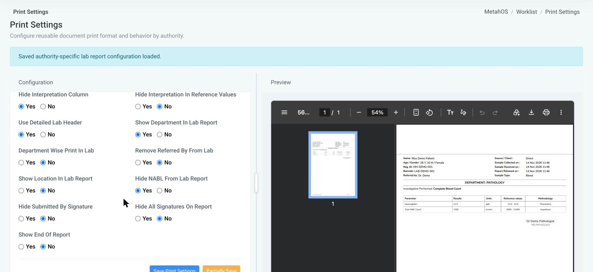

# Lab Report Print Settings

How a printed lab report looks — its margins, letterhead and layout options — is set **per authority** in **Print Settings**, with **Lab Report** as the document type. Each site can print on its own letterhead and with its own layout.

The Print Settings screen itself (choosing an authority, preview modes, the live preview, audit history and permissions) is described in [Print Settings](../billing/print-settings.md). This page covers what is specific to lab reports.

## At a glance

```steps
fa-cog | Open Print Settings | Worklist → Print Settings.
fa-hospital-o | Pick the authority | Choose the site, or apply to all your sites.
fa-file-text-o | Choose Lab Report | Select Lab Report as the document type.
fa-sliders | Set layout and options | Margins, letterhead mode and lab options.
fa-eye | Check the preview | A sample report shows the result live.
fa-save | Save | Reports for that site print this way from now on.
```

## Who can change it

Opening the Lab Report document type needs the **Lab Report** Print Settings permission, as well as the general **View** permission (to see the screen) and **Edit** permission (to save). See [Print Settings — permissions](../billing/print-settings.md#who-can-use-print-settings).

## Page layout

The lab report has the same layout fields as other documents — header and footer height, the four paddings, and the preview mode (**With Custom Letterhead**, **Plain Paper** or **Standard Header/Footer**). Its defaults differ slightly from a bill: header 100, footer 70, top padding 102, bottom 164, left and right 24.

## Lab report options

These options used to be set once for the whole hospital. They are now set per authority, and all default to **No**:



| Option | Effect |
| --- | --- |
| **Single Parameter Table Header** | Prints the parameter table's column headings once, instead of repeating them over each group of parameters. |
| **No Alternate Color In Lab** | Turns off alternating row shading. |
| **Hide Interpretation Column** | Leaves out the interpretation column. |
| **Hide Interpretation In Reference Values** | Leaves interpretation text out of the reference-range column. |
| **Use Detailed Lab Header** | Prints patient and sample details in a bordered box below the page header. |
| **Show Department In Lab Report** | Prints *Department From*: whether the patient came from OPD or an IP ward. |
| **Department Wise Print In Lab** | Starts each department's results on a new page. |
| **Remove Referred By From Lab** | Leaves out the referring doctor. |
| **Show Location In Lab Report** | Prints the name of the site (authority) as *Location*. |
| **Hide NABL From Lab Report** | Leaves out the NABL accreditation line. |
| **Hide Submitted By Signature** | Leaves out the signature of the person who submitted the results. |
| **Hide All Signatures On Report** | Leaves out every signature. |
| **Show End Of Report** | Prints *End of the Report* on the last page. |

The preview shows a sample report (*Demo Patient*, *Complete Blood Count*) in your site's report layout, with your unsaved changes applied.

## Which settings a report uses

A report always prints with the settings of the **authority the bill belongs to**. This applies everywhere a report is produced: printing, previewing and sending from the worklist, the report generated on approval, bulk approval, and saved reports.

- An authority with its own Lab Report settings uses them.
- An authority without its own settings uses the hospital-wide settings, but always with the **Standard Header/Footer** — never another site's custom letterhead.

:::info After the upgrade
The hospital-wide lab print options and paddings that were in use before v1.0.81 are copied into Print Settings automatically, so reports look the same after the upgrade. The custom letterhead image is **not** carried over automatically: if a site printed on a custom letterhead, choose **With Custom Letterhead** for that authority and upload its header and footer images.
:::
