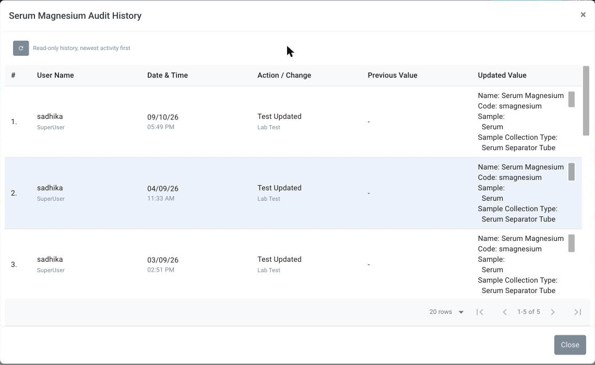

# Managing Lab Tests

Lab tests are created and maintained under **Lab → Manage Test**. This page covers three things that govern a test after it is built: its turnaround time unit, its audit history, and the rule that keeps a test active while a package still uses it. How to build a test's parameters and ranges is covered in [Parameters & Interpretation](./parameters-and-interpretation.md).

## At a glance

```steps
fa-flask | Edit the test | Change a field in Manage Test and save.
fa-history | Change recorded | The old and new value are logged with who and when.
fa-cubes | Deactivate? | The test is checked against active packages first.
fa-ban | Blocked if packaged | Remove it from those packages before deactivating.
fa-check | Test deactivated | Allowed only when no active package contains it.
```

## Turnaround time with a unit

The test form has a **TAT Value** and a **TAT Unit** — **Minutes**, **Hours** or **Days** — so a culture can be set to *3 Days* without converting it to 4,320 minutes. The Manage Test list shows the TAT with its unit. See [Turnaround Time & Alerts](./turnaround-time-and-alerts.md) for the rules.

## Audit history of a test

Each row in Manage Test has an **Audit History** button. It opens a read-only history of the test, newest activity first:

| Column | What it shows |
| --- | --- |
| User Name | Who made the change. |
| Date & Time | When it was made. |
| Action / Change | *Test Created*, *&lt;Field&gt; Updated*, *Test Deactivated* or *Test Activated*. |
| Previous Value | The value before the change. |
| Updated Value | The value after it. |

The fields tracked are: Test Name, Test Code, Department, Price, GST, Specimen Type, Container Type, Site, External ID, Barcode Identifier, TAT, TAT Unit, Parameters, Category, Report Template, No Table Report, Reference Files, Mobile Booking Configuration, Outsourced Default, and the test's Active/Inactive status. Changes made automatically when a test is synced to online booking are listed too.

The history is shown 20 entries at a time (50 or 100 can be chosen) and needs access to **Manage Test**.



:::note
This is the history of the **test definition**. The history of a patient's **results** is a separate view on the report screen — see [Report Navigation, Saving & Audit History](./report-navigation-and-audit.md#audit-history-for-results).
:::

## Deactivating a test that is in a package

A test cannot be deactivated while it is part of an **active package**. Deactivating it would leave the package selling a test the lab no longer runs.

When you try to deactivate such a test, an **Unable to Disable Lab Test** message lists the packages that contain it and asks you to remove the test from them first. Once no active package contains it, the usual confirmation appears and the test can be deactivated.

- Packages that are already disabled do not block deactivation.
- The same check applies when the test is disabled from the inventory item screens.
- Re-activating a test is never blocked.

:::tip
Use the list in the message as your checklist: open each package in **Facility → Package Management**, remove the test (or replace it with its successor), then come back and deactivate.
:::
