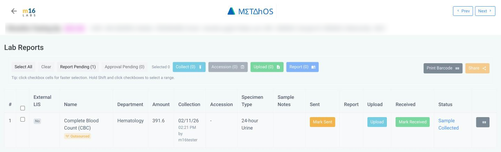
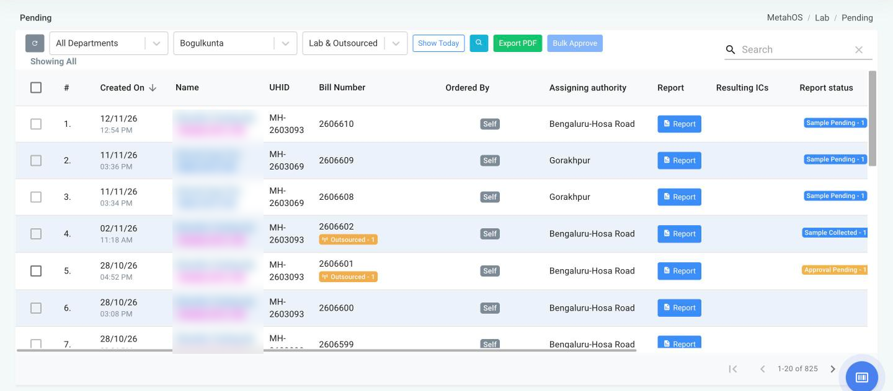

# Outsourced Tests

Some tests are sent to an external laboratory. Those tests are now handled **inside the ordinary Lab Reports modal** rather than in a separate screen, and their reports are folded into the patient's single combined report.

## At a glance

```steps
fa-flask | Collected | The sample is taken from the patient.
fa-paper-plane | Sent to the external lab | The sample is couriered out.
fa-upload | Report uploaded | The external lab's report file is attached.
fa-check | Received | The test is marked as received back.
fa-file-text-o | Merged into the patient report | Once received, the file is added to the combined report.
```

## One Report modal for everything

The separate **Outsourced Lab Reports** modal has been removed. The lab list now shows a single **Report** button, which opens the bill's in-house and outsourced tests together — limited to the tests that match the list you came from (see [Report Navigation](./report-navigation-and-audit.md)).

In the Report view:

- Outsourced tests carry an **Outsourced** badge, and their status column always shows where the test is in the outsourced sequence (below).
- **Sent** and **Received** columns appear, but only on bills that actually contain an outsourced test, so ordinary bills are unchanged.
- Outsourced rows are never accessioned, and show no accession controls.



The Report button is visible to anyone holding either the lab report permission or the permission to manage outsourced lab packages, so a coordinator who only handles outsourced work can still get in.

### Spotting outsourced work in the lists

- An orange **Outsourced - N** badge appears under the bill number in the **Pending** and **Completed** worklists, giving the number of outsourced tests on the booking.
- The **Completed** worklist has the same **Lab & Outsourced / Lab (In-house) / Outsourced** filter that Pending has. It is remembered with the screen's other filters, and the ZIP export follows it.
- On the patient journey, outsourced tests in the **Lab Results** list carry an **Outsourced** badge and their outsourced status.



## The outsourced sequence

The steps must happen in order. Each one unlocks the next:

1. **Collect** the sample.
2. **Mark as sent** — available once the sample has been collected.
3. **Upload the report** received from the external laboratory — available once the test has been marked sent.
4. **Mark as received** — available once a report file has been uploaded.

### Outsourced statuses

Each outsourced test shows a status that follows the sequence above:

| Status | Meaning |
| --- | --- |
| **Sample Pending** | The sample has not been collected. |
| **Sample Collected** | Collected, not yet sent to the external lab. |
| **Sent** | Sent to the external lab; waiting for its report. |
| **Uploaded** | The external report file is attached; waiting to be marked received. |
| **Completed** | The external report has been marked received. |

These appear as their own badges on worklist rows (in place of *Report Pending* for an outsourced test), and the **Lab Status** dropdown has matching **Outsource Sample Collected**, **Outsource Sent** and **Outsource Uploaded** options for roles that can manage outsourced lab packages.

## Reporting an outsourced test in-house

Sometimes the external laboratory does not deliver. An outsourced test can be **reported in-house instead**, using the normal result entry and approval flow — **as long as no external report has been uploaded for it**.

Because outsourced tests are never accessioned, only **collection** is required before results can be entered — requiring accession would make these tests permanently unreportable.

:::caution Once a file is uploaded, the external report is the report
After an external report is uploaded, that test is locked out of in-house reporting. Its report action is disabled (*An external report has already been uploaded for this test*), it is skipped by bulk approval and bulk report upload, and analyzer values are not written to it. The print and download buttons for the test serve the external file.

Other tests on the same bill are unaffected and can be reported normally.
:::

## Outsourced files in the combined report

The patient's combined report is generated from the structured results your lab entered, so a file uploaded for an outsourced test cannot be typed into it. Instead, the uploaded file is **appended to the generated report**, producing one document that carries the in-house results and the external laboratory's report together.

:::info An outsourced file is released only once it is received
A file is printed, sent or appended only after the test is marked **Received**. Uploading a file is not enough on its own — this gives someone the chance to check the external report before it reaches the patient. The same rule applies everywhere: worklist print and send, previews, the patient journey's consolidated print and the report generated on approval.
:::

A bill made up **only** of outsourced tests can now produce a report too: it begins with the uploaded file.

- PDF files are appended as their own pages.
- Images (JPG, PNG, TIFF) are placed on a page of their own.
- A test that was reported **in-house** is rendered as a normal structured test.

This applies both to the report generated on approval and to the report printed or previewed from the worklist and the patient journey.

:::info If a file cannot be fetched
If an attachment cannot be retrieved, the report is still produced with everything else intact — one unreachable file never costs you the in-house results, and never drops the other attachments.
:::

### When the report is compiled

A bill that mixes in-house and outsourced tests compiles its combined report once every test is either approved in-house **or** outsourced with a file uploaded.

:::note
Compilation is triggered by approval. If the outsourced file is uploaded or marked received **after** all the in-house tests were approved, the combined report is rebuilt at the next approval on that bill. Printing from the worklist or the patient journey always uses the current state, so it includes every received file.
:::

## How outsourced tests appear in the worklist

| Situation | Status |
| --- | --- |
| Not yet collected | `SAMPLE_PENDING`. |
| Collected, sent or uploaded | `REPORT_PENDING` — shown with the *Sample Collected*, *Sent* or *Uploaded* badge so it can be told apart from in-house work. Outsourced tests never wait in Accession Pending. |
| Results entered in-house, awaiting sign-off | `APPROVAL_PENDING` — it appears in the approval badge, the Approval Pending list and the move-to-next queue. |
| External report received, or reported in-house and approved | `COMPLETED`. |
| Sample rejected | `REJECTION`. |

:::note
The `BILLED` status used by earlier versions has been removed. Outsourced tests now appear in the normal Sample Pending and Report Pending lists, marked with their own badges.
:::
