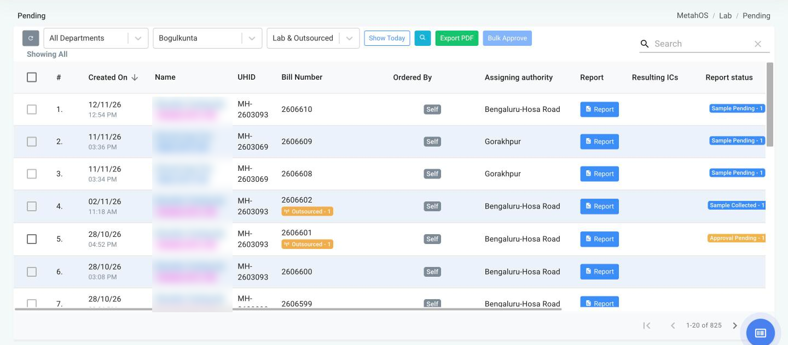

# Pending Worklists & Report Status

The **Pending** worklist is where most lab work happens. This page covers how a test is classified into a status, how the worklist can be split into one screen per status, and how the status filter is controlled per role.

## At a glance

```steps
fa-list | Pending (All) | One list with every test that still needs work.
fa-flask | Sample Pending | The sample has not been collected yet.
fa-barcode | Accession Pending | The sample is collected but the lab has not accessioned it yet.
fa-pencil | Report Pending | The sample is ready, so results can be typed in.
fa-check-square-o | Approval Pending | Results were submitted and a pathologist must sign off.
fa-check | Report Approved | The report is approved and the PDF exists.
fa-ban | Rejection | The sample was rejected and needs attention.
```

## The status of a test

Every test (package) on a lab order is classified into exactly one status. The classification is done **on the server**, so the badge on screen, the counts in the header, the PDF export and the sub-module lists can never disagree with each other.

| Status | Meaning |
| --- | --- |
| `SAMPLE_PENDING` | The sample has not yet been collected. |
| `ACCESSION_PENDING` | The sample has been collected, but a required accession step has not been accepted yet. |
| `REPORT_PENDING` | The sample is ready and results can now be entered. |
| `APPROVAL_PENDING` | Results were submitted and are waiting for a pathologist to approve. |
| `COMPLETED` | The report has been approved and generated for that test. |
| `CLEARED` | The order line has been cleared (billed / closed). |
| `REJECTION` | The sample was rejected at collection, at acceptance or by the department. |

:::note When is a test Accession Pending?
A collected test waits in `ACCESSION_PENDING` until **general accession** is accepted — and, on sites that accession in two stages, until **department accession** is accepted as well. A partially accepted sample counts as accepted. Sites that have accession turned off, and outsourced tests, skip this status and go straight to `REPORT_PENDING`.
:::

:::info
A single bill can hold several tests in different statuses at once — one test awaiting a sample while another is already approved. Each test carries its own sample, results and report.
:::



## One worklist per status

Sites can replace the single **Pending** tab with a set of per-status sub-modules in the Lab sidebar:

- **Sample Pending**
- **Accession Pending**
- **Report Pending**
- **Approval Pending**
- **Report Approved**
- **Pending (All)** — the combined list, still available alongside them

All of these are the same worklist screen with the status locked, so the columns, filters, bulk actions and export behave identically on each one.

:::note Why "Report Approved" and not "Completed"
The **Report Approved** sub-module is scoped to tests that are approved but **not yet cleared**. The separate top-level **Completed** worklist has a wider scope — fully completed orders. The different name keeps the two apart.
:::

### Rows now show only the status you asked for

When you filter by a status — whether through a sub-module or through the **Lab Status** dropdown — each row is narrowed to just the tests in that status, and the status badges and counters are recalculated from that narrowed set. A row left with no matching tests drops out of the list entirely.

This applies to the on-screen list and to the **Export PDF**, so a printed worklist always matches what you saw.

The exported PDF includes a **Bill Number** column, so a printed worklist can be reconciled against billing without going back to the screen.

## Who can see which status

Each per-status sub-module — **Sample Pending**, **Accession Pending**, **Report Pending**, **Approval Pending** and **Report Approved** — has its own permission, granted in the Role editor.

These are deliberately **independent** of the permission for the combined Pending worklist, so a role can be given a single status worklist — a phlebotomy team that only ever sees Sample Pending, for example — without access to the full list.

:::caution New permissions start switched off
These permissions are not on any existing role. After the sub-modules are turned on for your site, an administrator must grant them explicitly, or the new sidebar entries will not appear for anyone.
:::

### Restricting the Lab Status dropdown

The **Lab Status** dropdown on the worklist can also be restricted per role, so a user only sees the statuses they are meant to work on. Each option — **Sample Pending**, **Accession Pending**, **Report Pending**, **Approval Pending**, **Completed** and **Rejection** — has its own permission in the Role editor.

If a user does not hold the permission for a status, that option is hidden from the dropdown and cannot be applied. For Accession Pending, holding either the sub-module permission or the filter permission is enough to use the filter.

The dropdown also offers three options for following outsourced tests — **Outsource Sample Collected**, **Outsource Sent** and **Outsource Uploaded** — available to roles that can manage outsourced lab packages. See [Outsourced Tests](./outsourced-tests.md).

:::caution Orders from before the upgrade
The **Accession Pending** sub-module and filter, and the three outsourced options, match on a counter that older orders do not have yet. A test that was collected but not accessioned before the upgrade will not appear in them until its order is next saved. The status badge on each row is always correct.
:::

### IP Pending and IP Completed

The Lab sidebar's **IP Pending** and **IP Completed** screens were previously shown to every lab user. They now have their own permissions in the Role editor, one for each screen.

These are separate from the IP module's lab permission, which controls the same screens when they are opened from the IP module — so a role can be given one way in without the other.

### Columns that need a permission

Three columns in the lab order grids (Pending and its sub-modules, IP Pending, Completed and Cleared) are now shown only to roles that hold the matching permission, under **Lab → Order Grid Columns** in the Role editor: **Ordered By**, **Token Number** and **Resulting ICs**.

The existing screen rules still apply on top: Token Number appears only on the *today* view, Ordered By is hidden on Home Collection, and Resulting ICs is hidden on Cleared and Home Collection. The **Completed** grid now has an **Ordered By** column too, showing the referral doctor, the source doctor or *Self*.

:::caution Upgrading from v1.0.77
None of the permissions in this section — IP Pending, IP Completed and the three grid columns — is added to existing roles. Until an administrator grants them, the IP Pending and IP Completed entries disappear from the Lab sidebar and the three columns are hidden for everyone except roles with all permissions.
:::

## Rejected samples

**Rejection** is a status in its own right, so rejected samples can be pulled up as a worklist rather than being hunted for. A test is counted as rejected when the most recent action on its sample was a rejection, at any of the three stages:

- **Collection** — the sample was rejected when it was collected (see below).
- **Acceptance** — the sample was rejected on receipt at the lab.
- **Department** — the department rejected the sample (for example, insufficient quantity or a haemolysed sample).

Because the latest action wins, a sample that was rejected at acceptance or by the department and is then accepted is **not** shown as rejected — it returns to its normal place in the flow.

### Rejecting a sample at collection

The **Collect Sample** window has a **Rejected** option alongside Collected, Not Collected and Partially Collected. Choosing it makes **Reason for Rejection** mandatory, and the button changes to **Reject**. The reason is chosen from a fixed list:

- Labeling Errors
- Incorrect Tube or Container
- Insufficient Sample Volume (QNS)
- Sample Damage (Clotting or Hemolysis)
- Contamination or Leakage

The test moves to `REJECTION` and never counts as collected. The rejection and its reason are shown in red in the Lab Reports view, as *Sample Rejected* with the reasons in the Pending worklist's Home Collection status column, and as a *Rejected* badge in the rider's orders.

:::caution A collection rejection is final
Like every collection outcome, a rejection cannot be changed once saved — the system answers *Sample status has already been finalized and cannot be modified again.* Choose the reason carefully.
:::

## Department segregation

Lab lists, counts and bulk approval are scoped to the departments the signed-in user is allowed to work in, so a technician in Biochemistry does not see or act on Microbiology work. This scoping is applied on the server for the list, the export and bulk approval alike.
