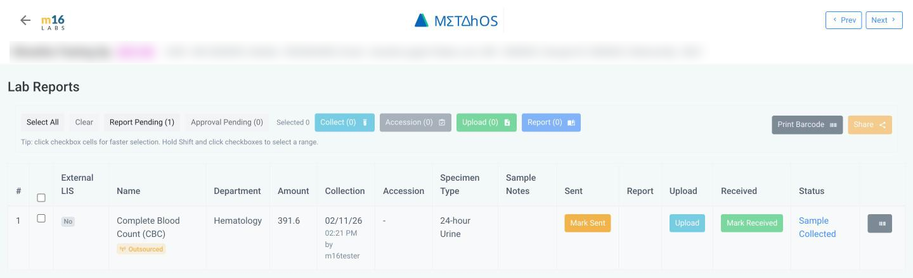

# Report Navigation, Saving & Audit History

This page covers working through a queue of reports without going back to the list each time, saving a report deliberately, and seeing exactly who changed a result and when.

## At a glance

```steps
fa-list | Open a report from a list | Start from the worklist you were already working in.
fa-pencil | Enter results | Type in what the analyser or bench produced.
fa-save | Save | Your edits are recorded, with who made them.
fa-check | Approve | A pathologist signs the report off.
fa-arrow-right | Next | Move straight to the next report in the same list.
fa-history | Audit history | Look back at every change made to a result.
```

## The report page

From **Pending** (and each of its status screens) and **Completed**, the **Report** button now opens the report as a **page of its own** (titled *Lab Reports*) rather than a pop-up. Because it is a page:

- The back arrow in the top bar returns you to the list exactly as you left it, filters included.
- The browser's Back button, a page refresh and a copied link all work.

The page shows only the tests that match the list you came from — its status, its **Department** filter and its **Outsourced** filter — so opening a report from *Approval Pending* in Biochemistry shows the Biochemistry tests awaiting approval, not the whole bill.

The Lab Queue and the IP screens still open reports in a pop-up.

If the test cannot be loaded, the page says *Failed to load this lab test* with **Retry** and **Back to list** buttons.



## Prev / Next through a worklist

Reports no longer have to be opened one at a time from the list. **Prev** and **Next** appear on the report page and in the Lab Reports pop-up. On the page, they swap the test in place and update the address, so Back still returns to the list. At either end of the list you'll see *No next test in this list* or *No previous test in this list*.

Next and Prev walk the **same list you opened the report from**, with the filters and sorting you had applied. If you were looking at Approval Pending for one department sorted oldest-first, Next gives you the next report in exactly that sequence.

If you opened the report without a list behind it, Next falls back to the approval queue — the oldest report still waiting for your approval, restricted to the departments, interpretation categories and sites you are allowed to approve for.

:::info
Prev and Next are always available, whatever your report permissions and whatever state the test is in — so navigation never dead-ends on a report you are not allowed to act on.
:::

## Separate permissions for pending and completed reports

The single report-button permission has been split in two: one for the **Report** button on all the pending worklists, and one for the **Report** button on the Completed worklist and Report Approved.

This lets a role open reports that are still in progress without being able to reach finished ones, or the reverse.

:::note Existing roles keep working
The old combined permission is still honoured as a fallback, so any role that already had it keeps access on both sides until it is explicitly re-assigned.
:::

## Saving a report

Result entry has an explicit **save** step, so a part-finished report can be put down and picked up again without being submitted for approval.

Parameters flagged as **hide in print if empty** can now be left blank and saved. Previously they were treated as required, which made a report with a blank flagged parameter impossible to save.

:::caution Blank rows are hidden, not deleted
A flagged parameter left empty is omitted from the **printed** report only. It stays in the saved report, so re-opening the report — or turning the flag off later — brings it back with everything else intact.
:::

## Audit history for results

Open **Audit History** from the report screen to see the full change history of a test's results.

Each entry records:

- The **parameter** that changed.
- The **value before** and the **value after**.
- **Who** made the change, by name.
- **When** it was made.

This covers edits made after a result was first entered, giving a complete trail for a corrected or amended report.

## Viewing lab results from the patient journey

Lab tests now appear on the patient journey **as soon as they are booked**, not only once a report exists. Each lab entry has a **Lab Results** button that opens the tests on that booking with their current status, grouped as Sample Pending, Accession Pending, Report Pending, Approval Pending, Completed, Rejection and Cleared. The window shows the booking date at the top.

Only that booking's tests are listed — earlier versions listed every order from the same day. Outsourced tests carry an **Outsourced** badge and their outsourced status.

Printing is limited to completed results, and is controlled by its own permission for viewing a patient's lab report, so results can be exposed to front-office or clinical staff without granting them the lab worklists. When more than one test is complete, **Print Consolidated (Completed Results Only)** prints them as one report, including any received outsourced files. The footer shows how many tests are complete (*Completed Tests: X / Y*).
